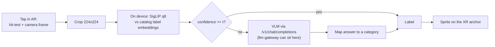

# xr-lens

Point at a product in AR and ask what it is. A small model on the device answers when it is confident. When it is not, the crop goes to a vision-language model behind an OpenAI-compatible API. The project's main result is the measured trade-off between what runs on the device and what goes to the cloud.

## Results

165 product photos: 105 from 15 catalog categories the device knows, and 60 from 15 categories it has never been given ("out of catalog"). The on-device tier is SigLIP (quantized) in headless Chromium through Transformers.js. The cloud tier is SmolVLM-500M on CPU, standing in for a hosted VLM. It is asked an open question and its answer is mapped to the 30 categories.

**Each tier alone**

| Tier | Catalog items | Out-of-catalog items | Median latency | Upload per query |
| --- | --- | --- | --- | --- |
| On-device only | **82.9%** | 0% (cannot know them) | 905 ms | 0 |
| Cloud only | 42.9% | **30.0%** | 1,967 ms (CPU proxy) | 2.5 KB |

**Routing: answer on the device at confidence ≥ t, otherwise escalate**

| t | Escalated | Out-of-catalog items escalated | Accuracy | p50 / p95 latency | KB per query |
| --- | --- | --- | --- | --- | --- |
| never | 0% | 0% | 52.7% | 905 / 1,072 ms | 0 |
| 0.4 | 16.4% | 43.3% | **56.4%** | 921 / 2,977 ms | 0.4 |
| 0.6 | 35.8% | 65.0% | **56.4%** | 972 / 3,115 ms | 0.9 |
| 0.8 | 64.8% | 90.0% | 50.3% | 2,789 / 3,174 ms | 1.7 |
| always | 100% | 100% | 38.2% | 2,910 / 3,275 ms | 2.7 |

What it shows:
- **Device confidence does separate known from unknown.** Median confidence was 0.80 on catalog items and 0.46 on items outside the catalog. At t = 0.6, 65% of unknown items go to the cloud while only about a fifth of known items do.
- **Routing beats either tier alone, but only modestly here, and the cloud model is why.** The best thresholds reach 56.4%, against 52.7% for device only and 38.2% for cloud only. A 500M-parameter VLM on 60×80-pixel catalog thumbnails identifies only 30% of the unknown items. Routing is worth exactly as much as the tier it escalates to. With a stronger hosted VLM, the out-of-catalog column is where the gain would show.
- **Latency follows the escalation rate.** Up to t = 0.6, the median query never leaves the device (under 1 s). From t = 0.7, more than half of queries escalate and the median jumps to the cloud path.

**The first cloud attempt failed, and the eval caught it.** SmolVLM-256M was given all 30 category names and asked to pick one. It answered "Tshirts" for 129 of 165 images, repeating the first option in the list. The current setup uses a larger model and an open question ("What kind of product is shown?") and maps the free-text answer to a category through a fixed alias list. Raw answers from both attempts are in `bench/results/`.

All latencies come from one 2-core container with no GPU, so the shape of the trade-off is the result, not the absolute times. Full tables: [bench/results/RESULTS.md](bench/results/RESULTS.md).

## Architecture



- `src/router/`: the on-device classifier, the routing policy, the cloud client and answer mapping. The offline sweep calls the same `route()` function that ships.
- `src/xr.ts`: an immersive-ar session with a hit-test reticle, anchors and Raw Camera Access. **Written to the WebXR specs; not yet tested on an AR device.**
- `src/main.ts`: uses AR where supported. Otherwise it runs the same pipeline on a camera feed in the page, and you click an object to ask.
- `server/vlm_server.py`: an OpenAI-compatible endpoint for the stand-in VLM.

Why the routing policy is the core and the AR shell stays thin: [ADR 1](docs/adr/0001-edge-cloud-router.md), decided by a judge after two advocates argued. Design and failure modes: [docs/architecture.md](docs/architecture.md). Eraser source: [docs/diagrams](docs/diagrams).

## Run it

```bash
npm ci && npm run models          # SigLIP q8 ONNX, about 200 MB, into public/models
npm test
pip install -r server/requirements.txt
VLM_MODEL=HuggingFaceTB/SmolVLM-500M-Instruct uvicorn server.vlm_server:app --port 8095
npm run dev                       # http://localhost:5173 (camera needs HTTPS or localhost)

# benchmark (eval images in public/eval, listed in manifest.json)
npm run bench:edge && npm run bench:cloud && npm run bench:sweep
```

Point the cloud tier anywhere OpenAI-compatible with `CLOUD_TARGET` (dev proxy) or `?cloud=` (page). Set the threshold with `?threshold=0.6`.

## Next

Masked crops from MediaPipe's interactive segmenter, measured against plain crops. Then on-device timings with WebGPU on real phones, and a test on an AR device.
