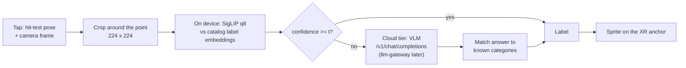

# Architecture

## Goals and non-goals

Goals:
- Point at an object in AR and get a label anchored where you pointed.
- Decide per query whether the device answers or the cloud does, and measure what that choice costs in accuracy, latency and bytes.
- Keep the cloud tier behind an OpenAI-compatible interface so a gateway or hosted provider can replace it without client changes.

Non-goals (v0.1):
- Segmentation before the query (masked crops): v0.2, measured against unmasked crops.
- Open-ended questions ("is this waterproof?"): the cloud tier answers a closed category question for now.

## Query flow

## Components

| Piece | Where it runs | Notes |
| --- | --- | --- |
| `src/router/edge.ts` | Browser (Transformers.js, WASM or WebGPU) | Label embeddings computed once; each query is one vision forward pass |
| `src/router/router.ts` | Browser | The policy and its offline evaluation share one function, so the sweep measures exactly what ships |
| `src/router/cloud.ts` | Browser to any OpenAI-compatible endpoint | One JPEG crop as a data URL; closed list of categories |
| `server/vlm_server.py` | Server | SmolVLM-256M on CPU as a stand-in for a cloud VLM |
| `src/xr.ts` | Browser, immersive-ar | Hit-test reticle, anchors, Raw Camera Access; written to spec, untested on a device |
| `src/main.ts` | Browser | Uses AR when supported; otherwise the same pipeline on a camera feed, click to ask |

## Why route instead of always asking the cloud

Asking the cloud for every query has one cost profile: every query pays the upload and the remote model's latency. Answering everything on the device is free and fast, but it can only pick from the labels it was given, so it is confidently wrong about anything outside the catalog. The threshold sits between those two. The sweep in `bench/results/RESULTS.md` shows where the useful settings are. Confidence on out-of-catalog items is what makes routing work or fail: if the device is as confident about unknown items as about known ones, no threshold separates them.

## Failure modes

| Failure | Effect | Mitigation |
| --- | --- | --- |
| Device confident on an unknown item | Wrong label, never escalated | Report out-of-catalog accuracy separately; add an explicit "other" prompt; v0.2 calibrates the threshold on held-out unknowns |
| Cloud answer outside the category list | No match, counted as wrong | Answer matching with plurals and containment; show "not sure" rather than a guess |
| Camera access not granted in AR | No frame to classify | AR shell falls back to a message; desktop fallback uses getUserMedia |
| Slow network | Escalated queries feel slow | Show the device's best guess immediately, then replace it with the cloud answer |

## Scaling path

1. **v0.1 (now):** router, on-device and cloud tiers, threshold sweep, AR shell, desktop fallback.
2. **v0.2:** MediaPipe interactive segmenter for masked crops (measured against unmasked crops); WebGPU on-device timings on real phones; test on an AR device.
3. **v0.3:** cloud tier through llm-gateway with caching; open questions answered by the shopping agent (evalgate-agent) about the identified product.
